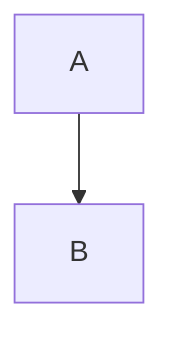

# Plan

Intro paragraph
spans two lines.

## Steps

- First item
- Second item
  - Nested one
  - Nested two
- Third item

1. Loose one

2. Loose two

> Quoted line
> continues.

| A | B |
| --- | --- |
| 1 | 2 |
| 3 | 4 |

```ts
const x = 1;
```

    indented code
    block



Last paragraph with <span data-x="1">raw html</span>.
